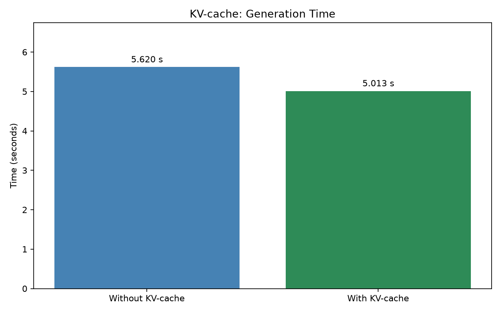
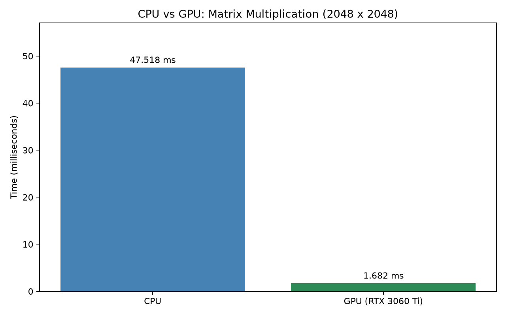

# LLM Decoder — Architecture and Performance

**Третий доклад по Python: исследование Transformer Decoder, Self-Attention, KV-cache и производительности GPU.**

## О проекте

В проекте исследуется работа Decoder-only языковых моделей на примере **Qwen2.5-1.5B-Instruct** (1,54 млрд параметров).

Реализованы:

- Локальный запуск предобученной LLM и генерация текста.
- Учебная реализация Causal Self-Attention на PyTorch.
- Эксперимент с включённым и выключенным KV-cache.
- Сравнение скорости матричного умножения на CPU и GPU.
- Автоматическое сохранение результатов в CSV и построение графиков.

## Технологии

Python 3.13, PyTorch, CUDA, Hugging Face Transformers, Accelerate, NumPy и Matplotlib.

**Оборудование:** NVIDIA GeForce RTX 3060 Ti, 8 ГБ VRAM.

## Основные результаты

| Эксперимент | Без ускорения / CPU | С ускорением / GPU | Ускорение |
|---|---:|---:|---:|
| Генерация 160 токенов, KV-cache | 5,620 с | 5,013 с | 1,12× |
| Умножение матриц 2048 × 2048 | 47,518 мс | 1,682 мс | 28,25× |

Для KV-cache проведено по 4 измерения на режим, для CPU/GPU — по 10. Итоговые значения рассчитаны через медиану.

Ускорение GPU относится к матричному умножению в FP32, а не ко всей языковой модели.

## Файлы проекта

| Файл | Назначение |
|---|---|
| `main.py` | Запуск Qwen и генерация текста |
| `check_gpu.py` | Проверка PyTorch и CUDA |
| `self_attention.py` | Демонстрация Self-Attention |
| `kv_cache.py` | Эксперимент с KV-cache |
| `benchmark.py` | Сравнение CPU и GPU |
| `visualize.py` | Построение графиков по CSV |
| `results/` | Результаты измерений и изображения |
| `requirements.txt` | Зависимости проекта |

## Установка и запуск

Рекомендуется Windows с NVIDIA GPU и активированным виртуальным окружением Python.

Установка CUDA-сборки PyTorch:

`python -m pip install torch==2.11.0 --index-url https://download.pytorch.org/whl/cu126`

Остальные зависимости:

`python -m pip install -r requirements.txt`

Первый запуск Qwen требует скачивания модели с Hugging Face.

**Команды запуска:**

- `python check_gpu.py` — проверка видеокарты.
- `python main.py` — генерация текста.
- `python self_attention.py` — демонстрация внимания.
- `python kv_cache.py` — измерение KV-cache.
- `python benchmark.py` — сравнение CPU/GPU.
- `python visualize.py` — обновление графиков.

Сначала выполняются эксперименты, затем строятся графики.

## Подробная документация

Полный теоретический разбор архитектуры Decoder, Self-Attention, KV-cache и исходного кода находится в [подробном докладе](docs/llm_decoder.md).

## Вывод

Проект демонстрирует основные механизмы Transformer Decoder и влияние кеширования и параллельных GPU-вычислений на производительность. Модель используется для инференса; обучение LLM с нуля не проводится.