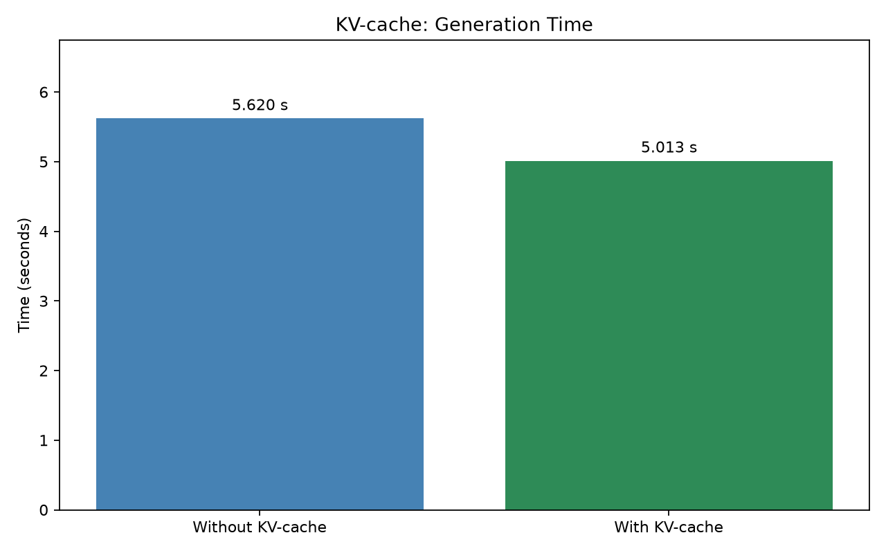
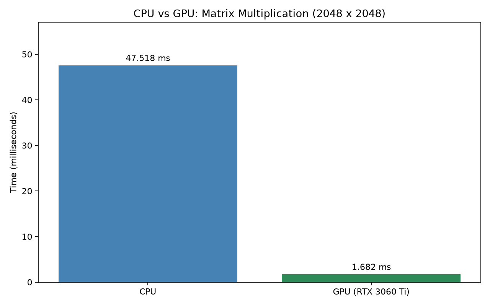

# Третий доклад по Python
# Transformer Decoder: архитектура, Self-Attention, KV-cache и производительность GPU

## 1. Цель работы

Цель проекта — изучить архитектуру Transformer Decoder на примере настоящей языковой модели и исследовать механизмы, которые влияют на скорость генерации текста.

В работе выполнены четыре основных требования:

1. Изучена архитектура Decoder-only Transformer.
2. Реализована демонстрация механизма Causal Self-Attention.
3. Исследована генерация текста с KV-cache и без него.
4. Проведено сравнение матричных вычислений на CPU и GPU.

В качестве модели используется **Qwen2.5-1.5B-Instruct**, которая запускается локально с помощью PyTorch и библиотеки Hugging Face Transformers.

Эксперименты проводились на NVIDIA GeForce RTX 3060 Ti с 8 ГБ видеопамяти.

---

## 2. Что такое LLM?

**LLM (Large Language Model)** — большая языковая модель, предназначенная для обработки и генерации текста.

В нашем проекте используется авторегрессионная LLM. Это означает, что модель создаёт текст последовательно: предсказывает следующий токен, добавляет его к последовательности и повторяет вычисления.

Например, для текста:

«Искусственный интеллект позволяет...»

модель оценивает вероятности возможных продолжений и выбирает следующий токен в соответствии с алгоритмом генерации.

Важно понимать: модель не хранит готовые ответы на все вопросы. Она использует параметры нейросети, полученные в процессе обучения, чтобы вычислять вероятности следующих токенов с учётом контекста.

### Почему выбрана Qwen2.5-1.5B-Instruct?

Модель подходит для нашего проекта, поскольку:

- Имеет настоящую архитектуру Transformer Decoder.
- Содержит около 1,54 млрд параметров.
- Имеет 28 слоёв Transformer.
- Поддерживает Causal Self-Attention и KV-cache.
- Может запускаться локально на RTX 3060 Ti.
- Позволяет проводить эксперименты без обучения модели с нуля.

В архитектуре модели используются 12 голов Query и 2 головы Key/Value. Такое устройство связано с механизмом Grouped-Query Attention (GQA).

Обозначение **Instruct** означает, что модель дополнительно адаптирована для выполнения инструкций и общения с пользователем.

---

## 3. Что такое Decoder?

**Decoder** — часть архитектуры Transformer, которая в нашем случае отвечает за обработку известного контекста и предсказание следующего токена.

В исходной архитектуре Transformer существовали Encoder и Decoder. Однако наша модель является **Decoder-only**, то есть не содержит отдельного Encoder.

Это соответствует заданию преподавателя: исследовать именно Decoder.

### Общая схема обработки текста или как LLM генерирует следующий токен

```text
┌──────────────────────────────────────────┐
│              ИСХОДНЫЙ ТЕКСТ              │
│         Запрос пользователя              │
└──────────────────────────────────────────┘
                     │
                     ▼
┌──────────────────────────────────────────┐
│                TOKENIZER                 │
│        Разбиение текста на токены        │
└──────────────────────────────────────────┘
                     │
                     ▼
┌──────────────────────────────────────────┐
│                TOKEN IDs                 │
│     Числовые идентификаторы токенов      │
└──────────────────────────────────────────┘
                     │
                     ▼
┌──────────────────────────────────────────┐
│                EMBEDDINGS                │
│       Векторные представления            │
└──────────────────────────────────────────┘
                     │
                     ▼
┌──────────────────────────────────────────┐
│           TRANSFORMER DECODER            │
│      Self-Attention + MLP + Norm         │
└──────────────────────────────────────────┘
                     │
                     ▼
┌──────────────────────────────────────────┐
│                  LOGITS                  │
│     Оценки возможных следующих токенов   │
└──────────────────────────────────────────┘
                     │
                     ▼
┌──────────────────────────────────────────┐
│           SOFTMAX + ВЫБОР ТОКЕНА         │
│      Вероятности и алгоритм выбора       │
└──────────────────────────────────────────┘
                     │
                     ▼
┌──────────────────────────────────────────┐
│             СЛЕДУЮЩИЙ ТОКЕН              │
│       Добавляется к последовательности   │
└──────────────────────────────────────────┘
                     │
                     ▼
          Процесс повторяется
```

**Важно:** модель генерирует ответ последовательно, по одному токену. После выбора нового токена он добавляется к контексту, и Decoder продолжает генерацию, пока не будет достигнуто условие завершения.

### 3.1. Tokenizer

**Токен** — единица текста, которую обрабатывает языковая модель.

Токеном может быть слово, часть слова, символ или другая последовательность символов.

Tokenizer преобразует исходный текст в числовые идентификаторы токенов.

Важно: одно слово не обязательно соответствует одному токену.

### 3.2. Embedding

Компьютер не передаёт текст напрямую в математические операции нейросети.

Поэтому идентификаторы токенов преобразуются в векторы чисел.

Такое преобразование выполняет слой **Embedding**.

Если токен имеет идентификатор 125, то после Embedding ему может соответствовать вектор из множества вещественных чисел.

Номер токена и его векторное представление — разные понятия.

### 3.3. Позиционная информация

Порядок слов влияет на смысл предложения.

Например, предложения «Кошка преследует собаку» и «Собака преследует кошку» состоят из похожих слов, но имеют разный смысл.

Поэтому модель должна учитывать расположение токенов.

В Qwen2.5 используется механизм **RoPE (Rotary Positional Embeddings)**, который добавляет информацию о позициях при вычислениях внимания.

### 3.4. Блоки Decoder

В модели Qwen2.5-1.5B используются 28 последовательно расположенных блоков Decoder.

Внутри них выполняются:

- Нормализация векторных представлений.
- Causal Self-Attention.
- Остаточные соединения (Residual Connections).
- Нелинейные преобразования через Feed Forward / MLP.

Self-Attention отвечает за взаимодействие между позициями последовательности.

Feed Forward обрабатывает векторные представления внутри каждой позиции.

Residual Connections помогают сохранять информацию и обеспечивают более устойчивую работу глубокой нейросети.

В Qwen также применяются RMSNorm и SwiGLU.


#### 3.4.1. Математика MLP, RMSNorm и SwiGLU

Self-Attention — важная, но не единственная часть блока Decoder.

В Qwen2.5 также используются нормализация RMSNorm, остаточные соединения и Feed Forward Network (MLP).

### RMSNorm

RMSNorm нормализует числовые представления, используя среднеквадратичное значение элементов вектора.

Упрощённая формула:

$$
RMSNorm(x)=
\frac{x}{\sqrt{\frac{1}{d}\sum_{i=1}^{d}x_i^2+\varepsilon}}
\odot\gamma
$$

Здесь:

- `x` — входной вектор.
- `d` — количество элементов вектора.
- `epsilon` — небольшая положительная константа для численной устойчивости.
- `gamma` — обучаемые коэффициенты масштабирования.
- `⊙` — поэлементное умножение.

**Зачем это нужно?**

Нормализация помогает контролировать масштаб внутренних представлений и способствует устойчивости вычислений в глубокой нейросети.

### MLP и SwiGLU

После Self-Attention в блоке Decoder применяется MLP.

В Qwen2.5 используется вариант Feed Forward Network с механизмом SwiGLU.

Для вектора `x` его можно записать следующим образом:

$$
MLP(x)=
W_{down}\left(
SiLU(W_{gate}x)\odot(W_{up}x)
\right)
$$

Здесь:

- `W_gate` — матрица управляющей проекции.
- `W_up` — матрица расширяющей проекции.
- `W_down` — матрица обратной проекции.
- `SiLU` — нелинейная функция активации.
- `⊙` — поэлементное умножение.

Функция активации:

$$
SiLU(x)=x\cdot\sigma(x)
$$

где сигмоидная функция:

$$
\sigma(x)=\frac{1}{1+e^{-x}}
$$

**Зачем это нужно?**

Self-Attention позволяет позициям обмениваться информацией.

MLP выполняет дополнительные нелинейные преобразования полученных представлений.

### Residual Connections

Остаточное соединение добавляет вход блока к результату его преобразования:

$$
y=x+F(x)
$$

Здесь:

- `x` — входное представление.
- `F(x)` — результат преобразования внутри блока.
- `y` — выход после остаточного соединения.

Это помогает сохранять исходную информацию и облегчает прохождение градиентов при обучении глубоких сетей.

**Вывод:** Self-Attention отвечает за взаимодействие между токенами, MLP — за нелинейные преобразования, RMSNorm — за нормализацию, а Residual Connections — за сохранение и передачу информации между слоями.


### 3.5. Выход модели

После прохождения блоков Decoder модель получает числовые оценки возможных следующих токенов — **logits**.

После преобразования logits в вероятности можно выбрать следующий токен.

Далее этот токен добавляется к уже известному тексту.


### 3.6. Математика предсказания следующего токена

После прохождения всех блоков Decoder модель должна определить, какой токен сгенерировать следующим.

Для этого выходной слой формирует **Logits** — числовые оценки для всех токенов словаря модели.

Logits не являются вероятностями: они могут принимать любые вещественные значения.

Чтобы преобразовать их в вероятности, используется функция Softmax:

$$
P(t_i)=\frac{e^{z_i}}{\sum_{j=1}^{V}e^{z_j}}
$$

**Обозначения:**

- `t_i` — рассматриваемый токен.
- `z_i` — Logit этого токена.
- `V` — размер словаря модели.
- `e` — основание натурального логарифма.
- `P(t_i)` — вероятность выбора токена после Softmax.

После преобразования сумма вероятностей всех возможных токенов равна единице.

**Пример:**

Предположим, что модель рассматривает три возможных продолжения:

| Токен | Logit | Вероятность |
|---|---:|---:|
| A | 2 | 66,5% |
| B | 1 | 24,5% |
| C | 0 | 9,0% |

В нашем `main.py` используется параметр:

`do_sample=False`

Он задаёт жадную генерацию (Greedy Decoding): модель выбирает токен с максимальной оценкой.

В приведённом примере это токен A.

Для такого выбора отдельно вычислять Softmax необязательно, потому что он сохраняет порядок Logits.

**Связь с проектом:** функция `model.generate()` выполняет авторегрессионную генерацию, последовательно выбирая новые токены по результатам вычислений Decoder.

---

## 4. Self-Attention

**Self-Attention — механизм, позволяющий каждому токену учитывать информацию из других доступных ему токенов той же последовательности.**

Для Decoder важно ограничение: токен может учитывать себя и предшествующие токены, но не будущие.

### Основная формула

$$
Attention(Q,K,V)=
softmax\left(\frac{QK^T}{\sqrt{d_k}}+M\right)V
$$


**Обозначения в формуле Self-Attention:**

- `Q` — Query, матрица запросов.
- `K` — Key, матрица ключей.
- `V` — Value, матрица значений.
- `d_k` — размерность одного вектора Key.
- `M` — аддитивная маска внимания.
- `softmax` — функция, преобразующая оценки внимания в нормализованные веса.

Разберём формулу по этапам.

### 4.1. Что такое Q, K и V?

Для каждого входного вектора модель вычисляет три новых представления: Query, Key и Value.

**Формулы вычисления:**

- `Q = X @ W_Q`
- `K = X @ W_K`
- `V = X @ W_V`

Здесь:

- `X` — матрица входных векторов токенов.
- `W_Q` — обучаемая матрица преобразования Query.
- `W_K` — обучаемая матрица преобразования Key.
- `W_V` — обучаемая матрица преобразования Value.
- `Q`, `K`, `V` — полученные матрицы.
- `@` — операция матричного умножения в Python.

**Простыми словами:**

- **Query** показывает, какую информацию ищет текущая позиция.
- **Key** используется для определения соответствия между позициями.
- **Value** содержит информацию, из которой формируется новое представление токена.

Матрицы преобразований являются обучаемыми параметрами нейросети.

В нашем `self_attention.py` они создаются случайным образом с помощью `torch.randn()`, поэтому демонстрация показывает математический механизм, а не реальные обученные зависимости Qwen.


Это условное объяснение назначения матриц. В действительности все они состоят из чисел и участвуют в обученных математических преобразованиях.


#### 4.1.1. Размерности матриц Q, K и V

Чтобы матричное умножение было возможно, размерности участвующих матриц должны быть согласованы.

Предположим, что мы обрабатываем последовательность из `n` токенов, каждый из которых представлен вектором размерности `d_model`.

Тогда входная матрица имеет размерность:

$$
X\in\mathbb{R}^{n\times d_{model}}
$$

**Обозначения:**

- `n` — количество токенов.
- `d_model` — размерность входного вектора одного токена.
- `d_k` — размерность Query и Key.
- `d_v` — размерность Value.

Матрицы преобразований имеют размерности:

$$
W_Q,W_K\in\mathbb{R}^{d_{model}\times d_k}
$$

$$
W_V\in\mathbb{R}^{d_{model}\times d_v}
$$

Поэтому после умножения получаем:

$$
Q,K\in\mathbb{R}^{n\times d_k}
$$

$$
V\in\mathbb{R}^{n\times d_v}
$$

Теперь вычислим произведение Query и транспонированной Key:

$$
QK^T:
(n\times d_k)(d_k\times n)
\longrightarrow(n\times n)
$$

Получается квадратная матрица размером `n × n`.

Каждая её строка соответствует позиции, которая запрашивает информацию, а каждый столбец — позиции, из которой эта информация может быть получена.

После применения Softmax и causal mask матрица весов внимания также имеет размерность `n × n`.

Умножение на Value даёт итоговый результат:

$$
(n\times n)(n\times d_v)
\longrightarrow(n\times d_v)
$$

### Связь с нашим self_attention.py

В нашем учебном примере:

- `n = 4` — четыре условных токена.
- `d_model = 4` — четыре числа в каждом входном векторе.
- `d_k = 4` — размерность Query и Key.
- `d_v = 4` — размерность Value.

Поэтому входная матрица имеет размерность:

$$
X\in\mathbb{R}^{4\times4}
$$

Матрицы Q, K и V также имеют размерность `4 × 4`.

Следовательно:

$$
QK^T\in\mathbb{R}^{4\times4}
$$

Именно поэтому в консоли программы мы видим матрицу внимания из четырёх строк и четырёх столбцов.

**Вывод:** размер матрицы внимания определяется количеством позиций последовательности, а размерность каждого выходного вектора — размерностью Value.

### 4.2. Вычисление оценок внимания

Следующий этап:

$$
S=\frac{QK^T}{\sqrt{d_k}}
$$

Операция \(QK^T\) вычисляет скалярные произведения между запросами и ключами.

Чем выше оценка, тем сильнее соответствующий ключ связан с запросом в рамках данного механизма.

Деление на \(\sqrt{d_k}\) используется для масштабирования оценок. Без него при больших размерностях значения могут становиться слишком большими, что затрудняет работу Softmax.

### 4.3. Зачем нужен Softmax?

Функция Softmax преобразует числовые оценки в неотрицательные веса:

$$
softmax(z_i)=\frac{e^{z_i}}{\sum_j e^{z_j}}
$$

После Softmax веса каждой строки суммируются в единицу.

Например, веса:

$$
[0{,}657;\;0{,}343;\;0;\;0]
$$

означают, что в учебном примере вторая позиция получает примерно 65,7% своего взвешенного представления от Value первой позиции и 34,3% — от Value второй.

Эти веса не следует напрямую интерпретировать как объяснение смысла предложения.

### 4.4. Что такое Causal Mask?

**Causal Mask запрещает позиции обращаться к будущим токенам.**

Например, для четырёх позиций:

| Позиция | 1 | 2 | 3 | 4 |
|---|---|---|---|---|
| 1 | Доступно | Запрещено | Запрещено | Запрещено |
| 2 | Доступно | Доступно | Запрещено | Запрещено |
| 3 | Доступно | Доступно | Доступно | Запрещено |
| 4 | Доступно | Доступно | Доступно | Доступно |

В нашей реализации запрещённые позиции получают оценку \(-\infty\) перед Softmax.

После применения Softmax их веса становятся нулевыми.

Это обеспечивает авторегрессионный принцип работы: предсказание не использует будущий текст.

---

## 5. Разбор `self_attention.py`

В этом файле мы самостоятельно реализовали упрощённый механизм одной головы Causal Self-Attention.

### 5.1. Условные токены

Используется последовательность:

`["LLM", "предсказывает", "следующий", "токен"]`

Она нужна для наглядности.

Важно: здесь токены не получены настоящим токенизатором Qwen. Мы просто обозначили четыре позиции текстовыми строками.

### 5.2. Входные векторы

Матрица `embeddings` содержит четыре строки и четыре столбца.

Каждая строка соответствует одной позиции последовательности.

В учебном примере использованы простые векторы:

- `[1, 0, 0, 0]`
- `[0, 1, 0, 0]`
- `[0, 0, 1, 0]`
- `[0, 0, 0, 1]`

Это не настоящие обученные Embeddings модели Qwen.

### 5.3. Матрицы преобразований

С помощью `torch.randn()` создаются матрицы `w_q`, `w_k` и `w_v`.

`torch.manual_seed(42)` фиксирует начальное состояние генератора случайных чисел, позволяя воспроизводить результаты.

Далее операции `@` выполняют матричное умножение:

- `q = embeddings @ w_q`
- `k = embeddings @ w_k`
- `v = embeddings @ w_v`

### 5.4. Матрица оценок

Операция:

`scores = q @ k.T / math.sqrt(d_k)`

вычисляет масштабированные оценки внимания.

`.T` означает транспонирование матрицы.

### 5.5. Маска

`torch.triu(..., diagonal=1)` создаёт маску над главной диагональю матрицы.

В нашем выводе:

`True` — позиция запрещена.

`False` — позиция доступна.

Затем `masked_fill()` заменяет запрещённые оценки на отрицательную бесконечность.

### 5.6. Веса внимания

`torch.softmax(masked_scores, dim=-1)` превращает оценки в веса.

Мы получили следующую матрицу:

| Позиция | Токен 1 | Токен 2 | Токен 3 | Токен 4 |
|---|---:|---:|---:|---:|
| 1 | 1,000 | 0 | 0 | 0 |
| 2 | 0,657 | 0,343 | 0 | 0 |
| 3 | 0,298 | 0,364 | 0,337 | 0 |
| 4 | 0,236 | 0,268 | 0,216 | 0,281 |

Отсюда видно, что первая позиция использует только собственную информацию, а четвёртая может учитывать все четыре позиции.

### 5.7. Итоговое представление

`output = attention_weights @ v`

Выполняется матричное умножение весов внимания на матрицу Value.

Результат содержит новые векторные представления позиций с учётом разрешённого контекста.

### 5.8. Проверки

В конце файла проверяем два свойства:

1. Сумма весов внимания каждой строки равна единице.
2. Все веса запрещённых маской позиций равны нулю.

Если условия выполнены, программа выводит сообщение об успешном прохождении проверок.

**Вывод:** наш `self_attention.py` показывает математический принцип Causal Self-Attention, хотя не повторяет полностью реализацию многоголового внимания Qwen.

---

## 6. Multi-Head Attention и GQA

В реальных языковых моделях вместо одной головы внимания используются несколько голов.

**Multi-Head Attention** позволяет выполнять несколько разных преобразований внимания параллельно.

Они могут изучать разные зависимости в последовательности.

В Qwen2.5-1.5B используются:

- 12 голов Query.
- 2 головы Key/Value.

Это механизм **Grouped-Query Attention (GQA)**.

При таком подходе несколько Query-голов используют общие Key/Value-головы.

Зачем это нужно?

Главная практическая причина — уменьшение объёма Key/Value, которые приходится хранить в KV-cache.

Это особенно полезно при генерации длинных последовательностей.

---

## 7. Что такое KV-cache?

**KV-cache — механизм сохранения ранее вычисленных Key и Value для повторного использования при генерации текста.**

Рассмотрим последовательную генерацию.

Сначала у модели есть исходный запрос. Затем она создаёт один новый токен, потом следующий и так далее.

Без кеширования при последовательных вызовах генерации могут заново вычисляться представления всех предыдущих токенов.

Но предыдущие токены уже известны. Их Key и Value в стандартном авторегрессионном режиме не нужно каждый раз рассчитывать повторно.

Поэтому их можно сохранить.

### 7.1. Как работает кеширование?

**Без KV-cache:**

На каждом шаге модель снова обрабатывает последовательность известных токенов.

**С KV-cache:**

Модель сохраняет ранее полученные Key и Value и вычисляет новые представления только для очередной позиции.

При этом новый Query всё равно взаимодействует с ключами предыдущих позиций.

Следовательно, KV-cache не устраняет вычисления внимания полностью, а сокращает повторную работу.

### 7.2. Почему это ускоряет генерацию?

Потому что модель избегает многократного пересчёта операций для уже обработанных токенов.

Эффект обычно увеличивается по мере роста контекста и количества генерируемых токенов.

Однако конкретное ускорение зависит от модели, аппаратного обеспечения и реализации библиотеки.


### 7.3. Вычислительная сложность генерации с KV-cache и без него

Рассмотрим математически, почему KV-cache способен ускорять авторегрессионную генерацию.

Предположим, что модель последовательно обрабатывает `T` токенов. Для простоты считаем размерности векторов и количество слоёв постоянными.

#### Генерация без KV-cache

При отсутствии кеширования на каждом шаге заново обрабатывается вся накопленная последовательность.

Для полного Self-Attention над последовательностью длины `t` вычисление матрицы внимания имеет сложность порядка:

$$
O(t^2)
$$

Это связано с тем, что между `t` позициями вычисляются оценки внимания, образующие матрицу размером `t × t`.

Если на каждом шаге заново вычислять внимание для последовательностей длины от 1 до `T`, получаем:

$$
1^2+2^2+\ldots+T^2
$$

Известная формула суммы квадратов:

$$
\sum_{t=1}^{T}t^2=
\frac{T(T+1)(2T+1)}{6}
$$

При больших `T` старший член пропорционален кубу длины последовательности.

Поэтому суммарная сложность **повторных вычислений полного внимания** имеет порядок:

$$
O(T^3)
$$

#### Генерация с KV-cache

При включённом KV-cache ранее вычисленные Key и Value сохраняются.

На очередном шаге достаточно вычислить Query, Key и Value для нового токена.

Query нового токена взаимодействует с ключами уже известных `t` позиций.

Поэтому стоимость вычисления внимания для нового токена растёт линейно относительно длины доступного контекста:

$$
O(t)
$$

За `T` последовательных шагов:

$$
1+2+\ldots+T=
\frac{T(T+1)}{2}
$$

Следовательно, суммарная сложность инкрементального внимания:

$$
O(T^2)
$$

### Сравнение

| Режим | Суммарная сложность внимания |
|---|---|
| Полный пересчёт без кеша | `O(T³)` |
| Инкрементальное внимание с кешем | `O(T²)` |

**Важно:** это асимптотическое сравнение именно вычислений внимания при последовательной генерации в упрощённой постановке.

Оно не означает, что вся LLM имеет точно такую же сложность или что реальное ускорение обязательно будет пропорционально `T`.

В модели также присутствуют матричные проекции, MLP, нормализация, обращения к памяти и другие операции.

Если исходный запрос уже содержит токены, его первоначальную обработку (Prefill) тоже необходимо учитывать.

### Связь с нашим экспериментом

В `kv_cache.py` мы сравниваем:

- `use_cache=False` — повторные вычисления без сохранения K/V.
- `use_cache=True` — сохранение и повторное использование K/V.

В эксперименте было 78 входных токенов и 160 новых токенов.

Полученное ускорение составило `1.12x`.

Оно меньше теоретического выигрыша отдельных операций, потому что измеряется полное время генерации, а не только вычисление матриц внимания.

### 7.4. Недостаток KV-cache

Кеш занимает оперативную память или видеопамять.

Для стандартного хранения K/V объём приблизительно пропорционален:

$$
Memory_{KV}\propto
2\cdot L\cdot B\cdot T\cdot H_{KV}\cdot d_h
$$


**Обозначения в формуле:**

- `L` — количество слоёв Decoder.
- `B` — размер батча (количество последовательностей, обрабатываемых одновременно).
- `T` — длина последовательности в токенах.
- `H_KV` — количество голов Key/Value.
- `d_h` — размерность одной головы внимания.
- `2` — множитель, учитывающий хранение двух матриц: Key и Value.

**Важно:** для вычисления объёма памяти в байтах результат необходимо умножить на количество байт одного элемента.

Таким образом, увеличение длины контекста увеличивает расход памяти.

---

## 8. Эксперимент `kv_cache.py`

В этом файле мы исследуем, насколько KV-cache ускоряет генерацию текста на Qwen2.5-1.5B-Instruct.

### Что делает программа?

Сначала загружается модель и токенизатор.

Далее создаётся одинаковый запрос, который преобразуется в токены.

После прогрева GPU запускаются два режима:

- `use_cache=False`
- `use_cache=True`

Оба режима генерируют по 160 токенов.

Для каждого выполняется четыре измерения.

### Зачем нужен прогрев?

Первые вычисления на GPU могут отличаться по времени из-за инициализации внутренних компонентов и изменения рабочих частот.

Прогрев помогает сделать последующие измерения более сопоставимыми.

### Зачем используется `torch.cuda.synchronize()`?

CUDA может выполнять операции асинхронно.

Это означает, что Python способен продолжить выполнение раньше, чем GPU фактически закончит вычисления.

Поэтому перед завершением измерения мы вызываем синхронизацию и дожидаемся окончания операций.

### Зачем `time.perf_counter()`?

Эта функция Python измеряет прошедшее время с высоким разрешением.

Мы используем её для оценки продолжительности генерации.

### Зачем несколько повторений?

Время выполнения зависит от текущей нагрузки и состояния оборудования.

Одно измерение может оказаться случайно быстрее или медленнее.

Поэтому мы проводим четыре повторения, чередуем порядок режимов и используем медиану.

### Результаты

| Повторение | Без KV-cache | С KV-cache |
|---|---:|---:|
| 1 | 5,73 с | 5,05 с |
| 2 | 5,47 с | 4,92 с |
| 3 | 5,64 с | 5,24 с |
| 4 | 5,60 с | 4,98 с |

Итоговые медианные значения:

**Без кеша:** 5,620 с.

**С кешем:** 5,013 с.

Ускорение:

$$
Speedup=\frac{T_{\text{without}}}{T_{\text{with}}}
$$

$$
Speedup=\frac{5{,}620}{5{,}013}\approx1{,}12
$$

Это означает, что в нашем эксперименте генерация с KV-cache выполнялась примерно в 1,12 раза быстрее.

По времени выигрыш составляет около 10,8%.



### Почему ускорение не очень большое?

Мы используем модель на 1,54 млрд параметров и относительно короткий запрос.

Генерация составляет 160 токенов, а длина исходного запроса — 78 токенов.

При такой последовательности выигрыш от кеширования может быть ограничен временем остальных вычислений модели.

Поэтому ускорение 1,12× является допустимым экспериментальным результатом.

Для более длинных последовательностей эффект может оказаться заметнее, но конкретное значение необходимо измерять.

---

## 9. Почему GPU быстрее CPU?

CPU и GPU предназначены для разных типов вычислительной нагрузки.

**CPU** — универсальный процессор, хорошо подходящий для выполнения разнообразных задач и последовательной логики.

**GPU** — вычислительное устройство с большим количеством параллельно работающих исполнительных блоков.

В архитектуре Transformer часто используются матричные операции.

Например:

$$
C=A\cdot B
$$

Каждый элемент результирующей матрицы вычисляется через умножение и сложение элементов исходных матриц:

$$
c_{ij}=\sum_{k=1}^{n}a_{ik}b_{kj}
$$

Многие из этих вычислений можно выполнять параллельно.

Поэтому GPU часто эффективнее CPU для крупных матричных операций.

При этом GPU не обязан быть быстрее для любой задачи. Маленькие вычисления или операции с частыми передачами данных могут не давать большого ускорения.

---

## 10. Эксперимент `benchmark.py`

В этом файле сравнивается производительность CPU и GPU при выполнении одинаковой математической операции.

### Что мы сравниваем?

Умножение двух матриц размером:

$$
2048\times2048
$$

Используем одинаковые исходные числа и формат данных FP32.

### Подготовка

С помощью `torch.randn()` создаются две матрицы на CPU.

Затем они копируются на GPU:

- `a_cpu.to("cuda")`
- `b_cpu.to("cuda")`

Таким образом, устройства работают с одинаковыми исходными значениями.

### Выполнение

Для матричного умножения используется:

`torch.matmul(a, b)`

Перед основными измерениями проводится пять прогревочных операций.

Затем выполняется по 10 измерений на каждом устройстве.

Итоговое значение — медиана.

### Зачем `torch.inference_mode()`?

Этот режим отключает вычисление градиентов и часть связанного с автоматическим дифференцированием служебного учёта.

Нам не нужно обучать модель или вычислять производные, поэтому он подходит для исследования скорости инференса.

### Итоговые результаты

| Устройство | Медианное время |
|---|---:|
| CPU | 47,518 мс |
| NVIDIA RTX 3060 Ti | 1,682 мс |

Ускорение:

$$
Speedup=\frac{47{,}518}{1{,}682}\approx28{,}25
$$

В нашем эксперименте GPU оказался примерно в 28,25 раза быстрее CPU.



### Важное ограничение

Этот результат относится **к матричному умножению размером 2048 × 2048**, а не к полной генерации языковой модели.

Время переноса данных между CPU и GPU в измерение не включается.

Поэтому утверждать, что Qwen генерирует текст в 28,25 раза быстрее на GPU, на основании нашего эксперимента нельзя.

---

## 11. Разбор `main.py`

Этот файл запускает настоящую предобученную LLM.

### 11.1. Импорт библиотек

`import torch` — использование PyTorch для работы с тензорами, GPU и инференсом.

`AutoTokenizer` — автоматическая загрузка подходящего токенизатора.

`AutoModelForCausalLM` — загрузка модели для авторегрессионной генерации.

### 11.2. Выбор устройства

`torch.cuda.is_available()` проверяет доступность CUDA.

Если CUDA доступна, выбираем `cuda`.

В противном случае используем `cpu`.

### 11.3. Формат чисел

Для GPU выбирается `torch.float16`.

FP16 занимает два байта на элемент и позволяет уменьшить расход видеопамяти по сравнению с FP32.

На CPU в нашем коде предусмотрен FP32.

### 11.4. Загрузка модели

`AutoTokenizer.from_pretrained(MODEL_NAME)` загружает токенизатор.

`AutoModelForCausalLM.from_pretrained(MODEL_NAME, dtype=dtype)` загружает архитектуру и веса.

`model.to(device)` переносит модель на выбранное устройство.

`model.eval()` переводит модель в режим оценки.

### 11.5. Подготовка диалога

Сообщения оформляются в виде списка словарей с полями `role` и `content`.

Для подготовки входа используется `tokenizer.apply_chat_template()`.

Параметр `add_generation_prompt=True` добавляет служебную разметку, обозначающую начало ответа модели.

`return_dict=True` позволяет получить объект с именованными данными, из которого извлекаются `input_ids`.

### 11.6. Генерация

Основная операция:

`model.generate(...)`

Используем:

- `max_new_tokens=150` — максимальное количество новых токенов.
- `do_sample=False` — детерминированный выбор следующего токена.
- `use_cache=True` — включение KV-cache.

### 11.7. Обратное преобразование

Модель возвращает идентификаторы токенов.

После генерации мы отделяем новые токены от исходного запроса.

`tokenizer.decode()` преобразует результат обратно в читаемый текст.

### Результат

Модель успешно загрузилась на RTX 3060 Ti и сгенерировала ответ на вопрос об устройстве Decoder.

Важно: полученный ответ содержал неточные формулировки. Это демонстрирует, что даже работающая LLM может генерировать фактические ошибки.

---

## 12. Разбор `check_gpu.py`

Этот файл проверяет аппаратную конфигурацию.

`torch.__version__` показывает версию PyTorch.

`torch.version.cuda` показывает версию CUDA, с которой собрана установленная версия PyTorch.

`torch.cuda.is_available()` проверяет, доступен ли CUDA-ускоритель.

`torch.cuda.get_device_name(0)` возвращает название первой доступной видеокарты.

`torch.rand(1000, 1000, device="cuda")` создаёт случайную матрицу непосредственно на GPU.

Мы получили:

- PyTorch 2.11.0+cu126.
- CUDA 12.6 в сборке PyTorch.
- Доступность GPU: True.
- NVIDIA GeForce RTX 3060 Ti.
- Устройство матрицы: `cuda:0`.

Это подтверждает работоспособность CUDA в нашем окружении.

---

## 13. Разбор `visualize.py`

Файл отвечает за визуализацию результатов экспериментов.

### Чтение данных

`csv.DictReader()` загружает результаты CSV в виде словарей.

Это позволяет обращаться к отдельным полям по именам.

### Обработка

Программа разделяет измерения на группы:

- Генерация с KV-cache и без кеша.
- Матричное умножение на CPU и GPU.

Затем используется `statistics.median()` для расчёта медианных значений.

### Визуализация

Для графиков применяется Matplotlib.

`plt.subplots()` создаёт фигуру и область построения.

`ax.bar()` строит столбчатую диаграмму.

`ax.bar_label()` добавляет значения над столбцами.

`plt.savefig()` сохраняет изображение в PNG.

`plt.close()` закрывает фигуру и освобождает ресурсы.

### Результат

Программа создаёт:

- `results/kv_cache_comparison.png`
- `results/cpu_gpu_comparison.png`

Оба графика строятся по экспериментальным CSV, без вручную записанных результатов.

---

## 14. Что подтверждают эксперименты?

Наш проект показывает два разных способа повышения эффективности вычислений.

### Первый — KV-cache

KV-cache уменьшает количество повторных вычислений во время авторегрессионной генерации.

В нашем случае ускорение составило 1,12×.

### Второй — GPU

GPU ускоряет крупные параллельные матричные операции.

В нашем случае ускорение матричного умножения составило 28,25×.

Эти механизмы нельзя считать одинаковыми.

**KV-cache** оптимизирует алгоритм вычислений, уменьшая повторную работу.

**GPU** предоставляет аппаратные возможности для параллельного выполнения математических операций.

Оба механизма могут применяться совместно.

---

## 15. Ограничения работы

В проекте необходимо учитывать следующие ограничения.

**Первое.** Мы используем предобученную модель и не обучаем LLM с нуля.

**Второе.** Учебная реализация Self-Attention использует случайные веса и условные векторы. Она объясняет математику внимания, но не воспроизводит все компоненты архитектуры Qwen.

**Третье.** Результаты производительности относятся к определённой аппаратной и программной конфигурации.

**Четвёртое.** Малое число повторов ограничивает точность оценивания производительности. Для более серьёзного исследования потребовались бы дополнительные измерения.

**Пятое.** Тест CPU/GPU не измеряет скорость всей LLM.

---

## 16. План устной защиты

### Вступление

«В третьем докладе я исследовал архитектуру Transformer Decoder, которая используется в современных авторегрессионных языковых моделях.

В качестве примера я взял Qwen2.5-1.5B-Instruct, содержащую около 1,54 млрд параметров.

Работу я разделил на теоретическую и практическую части».

### Архитектура

«Сначала текст разбивается токенизатором на токены, после чего они преобразуются в числовые представления.

Далее данные проходят через последовательность блоков Decoder.

Внутри блоков используется Causal Self-Attention, позволяющий каждой позиции учитывать только уже доступный контекст».

### Self-Attention

«Чтобы разобраться в математике, я написал собственную упрощённую реализацию Self-Attention на PyTorch.

Программа формирует Q, K, V, вычисляет оценки внимания, применяет causal mask, нормализует оценки через Softmax и получает новые представления токенов.

В конце программа проверяет, что веса каждой строки суммируются в единицу и что будущие позиции действительно скрыты».

### KV-cache

«Затем я исследовал KV-cache.

При последовательной генерации кеш позволяет сохранять ранее вычисленные Key и Value, чтобы не пересчитывать их на каждом шаге.

Я провёл по четыре измерения в двух режимах и получил ускорение приблизительно 1,12 раза».

### CPU и GPU

«Последний эксперимент посвящён производительности CPU и GPU.

Я сравнил умножение одинаковых матриц размером 2048 на 2048 в формате FP32.

На CPU медианное время составило 47,518 миллисекунды, а на RTX 3060 Ti — 1,682 миллисекунды.

Ускорение получилось примерно 28,25 раза.

Это демонстрирует преимущество параллельных вычислений GPU при выполнении крупных матричных операций».

### Заключение

«Таким образом, я не только запустил настоящую языковую модель, но и отдельно исследовал механизм внимания, эффективность кеширования и аппаратное ускорение вычислений.

Работа помогла понять, как связаны архитектура Transformer и производительность генерации текста».

---

## 17. Вопросы, которые могут задать на защите

**Почему именно Decoder?**

Потому что наша задача связана с авторегрессионной генерацией текста, а выбранная модель использует Decoder-only архитектуру.

**Чем токен отличается от Embedding?**

Токен — единица текста. Embedding — числовое векторное представление токена.

**Зачем нужны Q, K и V?**

Они позволяют вычислять оценки соответствия позиций и формировать взвешенные представления информации.

**Почему используется Softmax?**

Чтобы превратить оценки внимания в неотрицательные веса, суммирующиеся в единицу.

**Зачем нужна causal mask?**

Чтобы текущая позиция не учитывала будущие токены.

**Почему KV-cache ускоряет генерацию?**

Потому что сохраняет уже вычисленные ключи и значения и позволяет не пересчитывать их для предыдущих токенов.

**Почему кеш не ускорил генерацию в несколько раз?**

Потому что эффект зависит от длины последовательности, характеристик модели и накладных расходов. В нашем коротком эксперименте ускорение составило 1,12×.

**Почему GPU быстрее CPU?**

Потому что GPU способен выполнять большое количество однотипных математических операций параллельно, что особенно эффективно для крупных матриц.

**Почему ускорение 28,25× нельзя переносить на всю LLM?**

Потому что эксперимент измерял только одну операцию — матричное умножение.

**Зачем отключать градиенты?**

Потому что мы проводим инференс, а не обучение. Для генерации текста вычислять производные параметров не требуется.

**Почему модель иногда отвечает неправильно?**

Потому что LLM генерирует текст на основе вероятностных закономерностей, а не выполняет гарантированную проверку истинности утверждений.

---

## 18. Заключение

В результате работы удалось:

- Локально запустить Qwen2.5-1.5B-Instruct.
- Изучить структуру Decoder-only Transformer.
- Реализовать учебный механизм Causal Self-Attention.
- Продемонстрировать действие causal mask.
- Провести эксперимент по KV-cache.
- Измерить скорость матричного умножения на CPU и GPU.
- Сохранить результаты и построить графики.

Основной результат проекта — практическое исследование архитектуры и механизмов ускорения языковых моделей.

## Источники

1. [Qwen2.5-1.5B-Instruct — Hugging Face](https://huggingface.co/Qwen/Qwen2.5-1.5B-Instruct)
2. [Transformers — KV-cache](https://huggingface.co/docs/transformers/kv_cache)
3. [Transformers — How caching works](https://huggingface.co/docs/transformers/cache_explanation)
4. [PyTorch Documentation](https://docs.pytorch.org/docs/stable/index.html)
5. Vaswani et al. (2017). *Attention Is All You Need*.